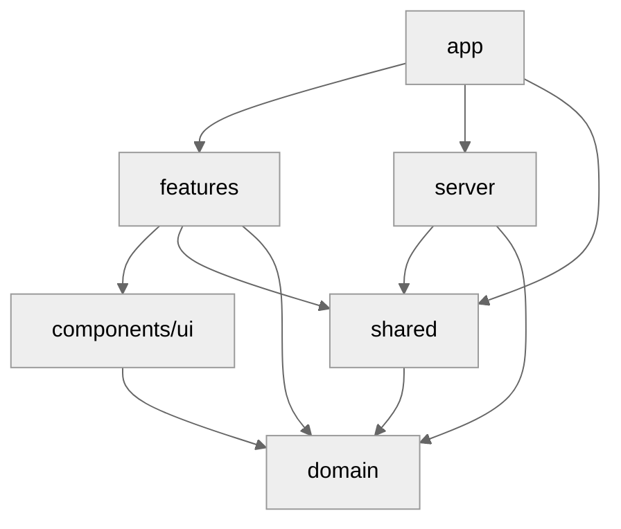
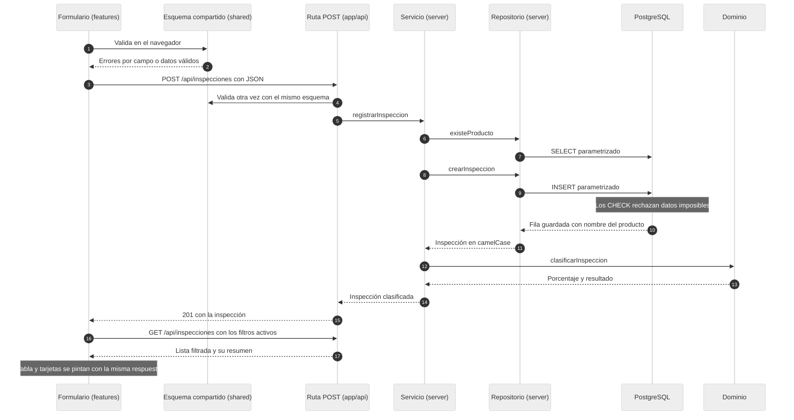
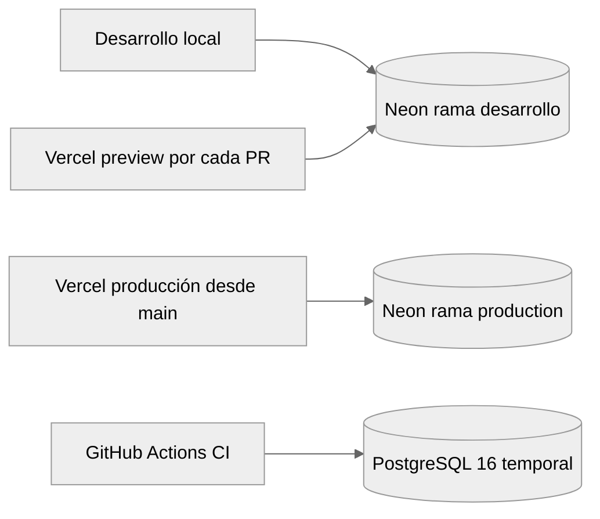

# Arquitectura

Documentación técnica del proyecto, para el equipo que lo mantiene: capas, recorrido de una petición, ambientes, modelo de datos, contrato de la API y decisiones con su porqué.

## Contenido

- [Capas](#capas)
- [Recorrido de un registro](#recorrido-de-un-registro)
- [Ambientes](#ambientes)
- [Modelo de datos](#modelo-de-datos)
- [Contrato de la API](#contrato-de-la-api)
- [Decisiones técnicas](#decisiones-técnicas)
- [Cómo cambiar el límite de 5% a 3%](#cómo-cambiar-el-límite-de-5-a-3)

## Capas

| Capa              | Carpeta                                                       | Responsabilidad                                                                                        |
| ----------------- | ------------------------------------------------------------- | ------------------------------------------------------------------------------------------------------ |
| **app**           | [`src/app/`](../src/app/)                                     | Rutas. `page.tsx` solo compone la pantalla; `api/*/route.ts` traduce HTTP. Sin lógica de negocio.      |
| **domain**        | [`src/domain/`](../src/domain/)                               | Reglas de negocio puras: clasificación y resumen. Sin React, sin base de datos, sin Next.              |
| **server**        | [`src/server/`](../src/server/)                               | Solo servidor (`import "server-only"`): pool de `pg`, repositorio SQL, servicio y respuestas de error. |
| **shared**        | [`src/shared/`](../src/shared/)                               | Esquemas Zod y tipos que usan cliente y servidor. Un solo esquema valida formulario y API.             |
| **features**      | [`src/features/inspecciones/`](../src/features/inspecciones/) | Componentes, hooks y cliente HTTP de la pantalla.                                                      |
| **components/ui** | [`src/components/ui/`](../src/components/ui/)                 | Componentes visuales reutilizables, sin lógica de negocio.                                             |

### Regla de dependencias

Las dependencias apuntan hacia el dominio, nunca al revés:



- **domain** no importa nada del proyecto.
- **server** solo lo importan las rutas de `app/api`; si un componente de cliente lo importa, el build falla por `server-only`.
- **features** nunca habla con la base: pasa siempre por la API con [`api-client.ts`](../src/features/inspecciones/api-client.ts).
- **components/ui** solo importa el tipo `Resultado` del dominio, para el sello de resultado.

## Recorrido de un registro

Qué pasa desde que el inspector pulsa Guardar hasta que la fila aparece en la tabla:



Si el esquema falla en la ruta, responde 400 con los mensajes por campo. Si el producto no existe, el servicio lanza `ErrorDeValidacion` y la ruta responde 400. Cualquier otro error responde 500 con un mensaje genérico.

## Ambientes



| Ambiente   | `DATABASE_URL` apunta a | Datos                                                       |
| ---------- | ----------------------- | ----------------------------------------------------------- |
| Local      | Neon `desarrollo`       | Seed más lo que se capture al desarrollar                   |
| Preview    | Neon `desarrollo`       | Igual que local                                             |
| Producción | Neon `production`       | Solo la demo                                                |
| CI         | PostgreSQL 16 temporal  | Migraciones y seed en cada corrida; se destruye al terminar |

Las migraciones de producción se aplican a mano antes de integrar un cambio de esquema: `DATABASE_URL="<url de production>" npm run db:migrate`.

## Modelo de datos

Definido en [`db/migrations/001_crear_tablas.sql`](../db/migrations/001_crear_tablas.sql); el catálogo se carga en [`002_catalogo_productos.sql`](../db/migrations/002_catalogo_productos.sql).

**`productos`**

| Columna  | Tipo         | Restricción      |
| -------- | ------------ | ---------------- |
| `codigo` | VARCHAR(10)  | Llave primaria   |
| `nombre` | VARCHAR(100) | NOT NULL, UNIQUE |

**`inspecciones`**

| Columna                | Tipo        | Restricción                                        |
| ---------------------- | ----------- | -------------------------------------------------- |
| `id`                   | BIGINT      | Identity, llave primaria                           |
| `producto_codigo`      | VARCHAR(10) | NOT NULL, referencia a `productos`                 |
| `lote`                 | VARCHAR(50) | NOT NULL, `CHECK (length(trim(lote)) > 0)`         |
| `fecha`                | DATE        | NOT NULL                                           |
| `unidades_revisadas`   | INTEGER     | NOT NULL, `CHECK (> 0)`                            |
| `unidades_defectuosas` | INTEGER     | NOT NULL, `CHECK (>= 0 AND <= unidades_revisadas)` |
| `creado_en`            | TIMESTAMPTZ | NOT NULL, `DEFAULT now()`                          |

Índice `(fecha DESC, creado_en DESC)` para el orden del listado. **El porcentaje y el resultado no son columnas:** se calculan al leer.

`schema_migrations` la crea [`scripts/migrate.mjs`](../scripts/migrate.mjs) y registra cada migración aplicada.

## Contrato de la API

Rutas en [`src/app/api/inspecciones/route.ts`](../src/app/api/inspecciones/route.ts) y [`src/app/api/productos/route.ts`](../src/app/api/productos/route.ts); tipos en [`src/shared/inspeccion.types.ts`](../src/shared/inspeccion.types.ts).

| Método y ruta            | Parámetros                                                                             | Respuesta correcta              |
| ------------------------ | -------------------------------------------------------------------------------------- | ------------------------------- |
| `GET /api/productos`     | —                                                                                      | 200 `{ productos }`             |
| `GET /api/inspecciones`  | `producto` y `resultado`, ambos opcionales                                             | 200 `{ inspecciones, resumen }` |
| `POST /api/inspecciones` | JSON con `productoCodigo`, `lote`, `fecha`, `unidadesRevisadas`, `unidadesDefectuosas` | 201 `{ inspeccion }`            |

Cada inspección regresa `id`, `productoCodigo`, `productoNombre`, `lote`, `fecha` (AAAA-MM-DD), `unidadesRevisadas`, `unidadesDefectuosas`, `porcentaje` (sin redondear), `resultado` y `creadoEn` (ISO 8601). El `resumen` trae `totalInspecciones`, `totalRevisadas`, `totalDefectuosas` y `porcentajeGlobal` (`null` sin datos).

| Error | Cuándo                                                            | Cuerpo                                                                                       |
| ----- | ----------------------------------------------------------------- | -------------------------------------------------------------------------------------------- |
| 400   | Datos inválidos, query inválida, producto inexistente o JSON roto | `{ error: "VALIDACION", campos: { campo: "mensaje" } }`; el JSON roto va en `campos.general` |
| 500   | Cualquier error inesperado                                        | `{ error: "ERROR_INTERNO", mensaje }` con texto genérico                                     |

Ejemplo:

```bash
curl "https://inspecciones-calidad.vercel.app/api/inspecciones?producto=P001&resultado=Rechazado"
```

## Decisiones técnicas

| Decisión                                           | Por qué                                                                                                                                                                                                                                                                                                   |
| -------------------------------------------------- | --------------------------------------------------------------------------------------------------------------------------------------------------------------------------------------------------------------------------------------------------------------------------------------------------------- |
| **El resultado y el porcentaje no se guardan**     | Se calculan al leer con `src/domain/`. Un cambio de límite reclasifica todo el historial sin migrar datos.                                                                                                                                                                                                |
| **Lista filtrada y resumen en la misma respuesta** | El servicio calcula el resumen sobre la lista que regresa, así tabla y tarjetas no pueden contradecirse.                                                                                                                                                                                                  |
| **Límites en constantes del dominio**              | `LIMITE_APROBADO` y `LIMITE_OBSERVACIONES` en [`clasificacion.ts`](../src/domain/clasificacion.ts) son la única fuente; el medidor de la vista previa se dibuja a partir de ellas.                                                                                                                        |
| **Un solo esquema Zod para formulario y API**      | [`inspeccion.schema.ts`](../src/shared/inspeccion.schema.ts) define reglas y mensajes una vez; el cliente y el servidor no pueden discrepar.                                                                                                                                                              |
| **Validación en tres capas**                       | El formulario da respuesta inmediata, la API protege de clientes que no son el formulario y los `CHECK` protegen de inserciones directas.                                                                                                                                                                 |
| **Fechas como texto AAAA-MM-DD**                   | `pg` convierte `DATE` en un `Date` a medianoche local; al serializar a UTC, "2026-10-16" puede verse como el 15 en México. [`db.ts`](../src/server/db.ts) deja el `DATE` como texto, la pantalla lo formatea sin crear un `Date` y "hoy" se calcula en `America/Mexico_City`, no en la zona del servidor. |
| **Consultas parametrizadas**                       | Los valores viajan en `$1, $2…`, separados del SQL; un texto malicioso nunca se ejecuta como código. El filtro opcional usa `$1 IS NULL OR …` para tener una sola consulta fija.                                                                                                                          |
| **Sin `z.coerce`**                                 | `coerce` convierte `""` y `null` en `0`: un campo vacío pasaría como "0 unidades". El formulario manda números reales o `undefined`, y el esquema marca el campo como obligatorio.                                                                                                                        |
| **`AbortController` en las cargas**                | Cada cambio de filtro cancela la petición anterior en [`useInspecciones.ts`](../src/features/inspecciones/useInspecciones.ts); una respuesta vieja nunca pisa la nueva al cambiar rápido de filtro.                                                                                                       |
| **Comparación con enteros**                        | Se evalúa `defectuosas * 100 <= revisadas * LIMITE` en lugar de dividir. `7 / 100 * 100` da `7.000000000000001` y un caso en el borde caería del lado equivocado.                                                                                                                                         |
| **Errores 500 sin detalles**                       | [`respuestas.ts`](../src/server/respuestas.ts) manda un mensaje genérico; el detalle va solo al log del servidor, porque puede revelar tablas, columnas o datos de conexión.                                                                                                                              |
| **`await connection()` en los GET**                | Con `cacheComponents` no existe `export const dynamic`; `connection()` obliga a responder en cada petición en lugar de servir una respuesta generada al compilar.                                                                                                                                         |
| **Pool creado al primer uso**                      | El build no necesita `DATABASE_URL`, y el pool se guarda en `globalThis` para no abrir conexiones nuevas en cada recarga en caliente.                                                                                                                                                                     |
| **`id` BIGINT como texto**                         | JavaScript no representa con exactitud enteros mayores a 2^53, así que el `id` viaja como string.                                                                                                                                                                                                         |
| **Neon frente a Supabase y Render**                | El plan gratuito de Neon suspende el cómputo sin uso pero no pausa el proyecto ni borra la base; Supabase pausa los proyectos gratuitos inactivos y Render elimina su PostgreSQL gratuito al cabo de un plazo. Neon además ofrece ramas, que separan producción de desarrollo sin otra cuenta.            |

## Cómo cambiar el límite de 5% a 3%

1. **Archivo y constante:** en [`src/domain/clasificacion.ts`](../src/domain/clasificacion.ts) cambia `LIMITE_APROBADO = 5` por `LIMITE_APROBADO = 3`. No hace falta migrar la base: todo el historial se reclasifica en la siguiente lectura.
2. **Pruebas unitarias a ajustar:**
   - [`src/domain/clasificacion.test.ts`](../src/domain/clasificacion.test.ts): el caso 20 revisadas y 1 defectuosa (5%) pasa de Aprobado a Con observaciones. Agrega los nuevos bordes, por ejemplo 100/3 (3%, Aprobado) y 100/4 (4%, Con observaciones).
   - [`src/server/inspecciones.service.test.ts`](../src/server/inspecciones.service.test.ts): la fila 20/1 (5%) pasa a Con observaciones en la lista esperada.
3. **Pruebas E2E a ajustar:** en [`e2e/criterio-aceptacion.spec.ts`](../e2e/criterio-aceptacion.spec.ts), el caso 100/5 (5.00%) pasa a Con observaciones; cambia el borde de Aprobado a 100/3.
4. **Sin cambios de código en la pantalla:** el medidor de la vista previa toma los límites de las constantes y mueve sus marcas solo.
5. **Textos a actualizar:** comentarios de [`db/seeds/001_inspecciones_demo.sql`](../db/seeds/001_inspecciones_demo.sql) (5% y 3.33% dejan de ser Aprobado), el [README](../README.md) y el [manual de usuario](manual-de-usuario.md).
6. Corre `npm test` y `npm run test:e2e`, y abre el PR. Como el límite es regla de negocio, el cambio debe confirmarlo negocio antes de integrarse.
