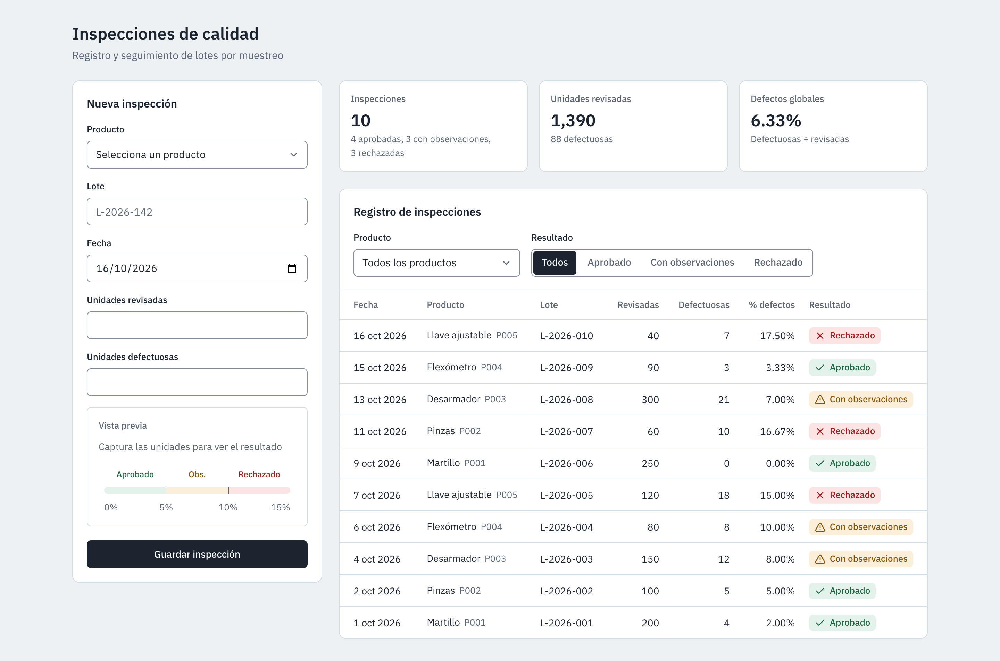
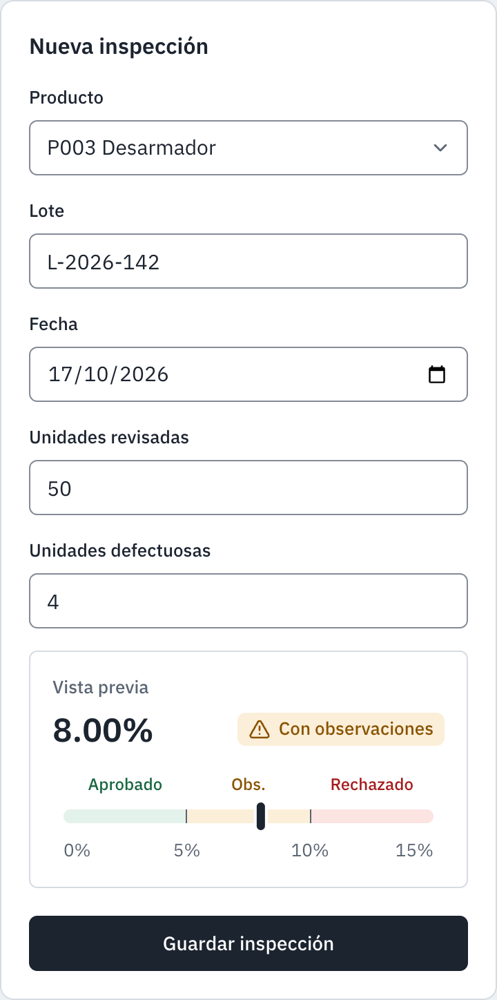
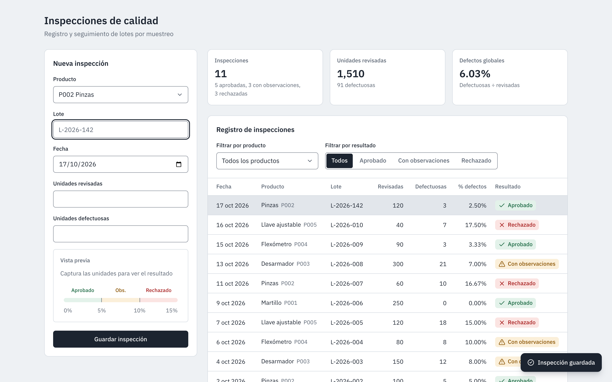
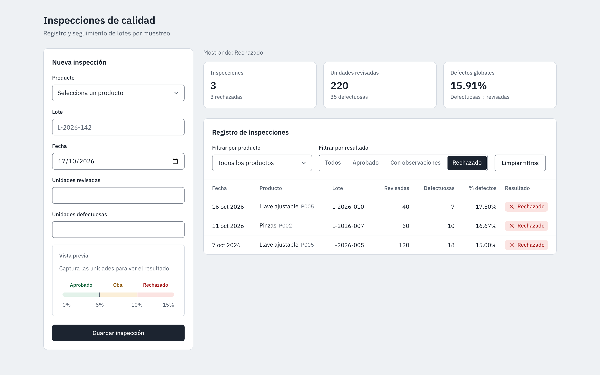
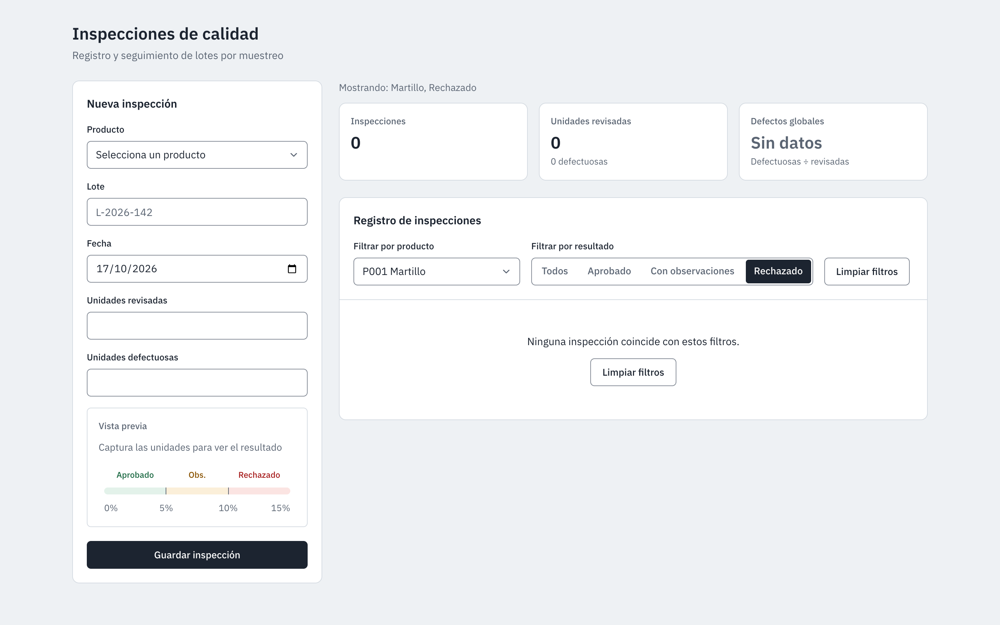
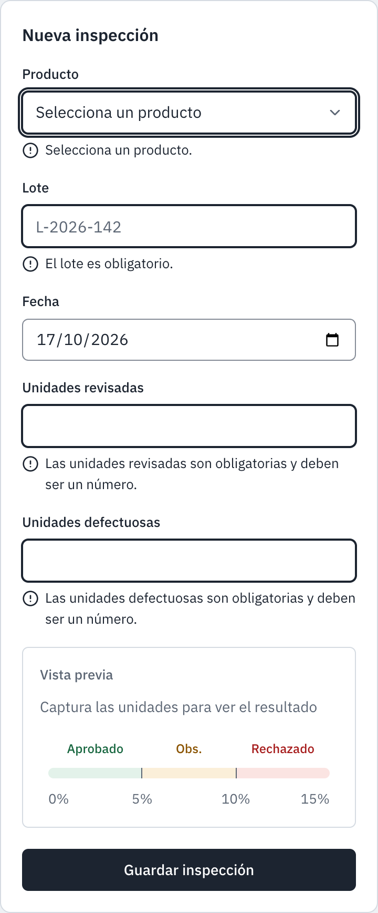
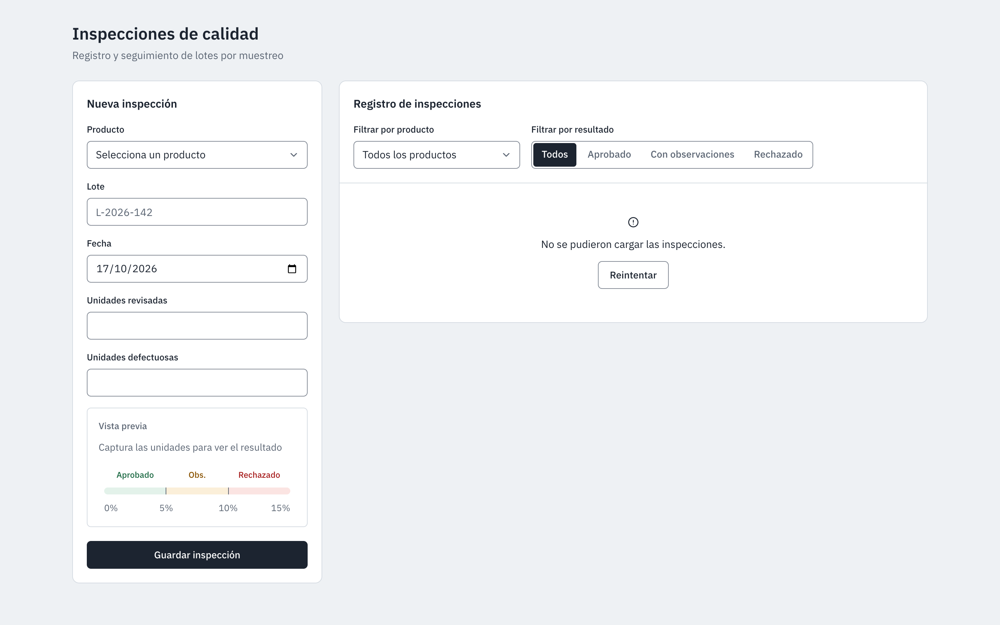
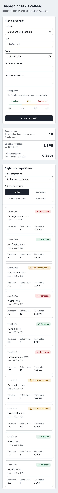
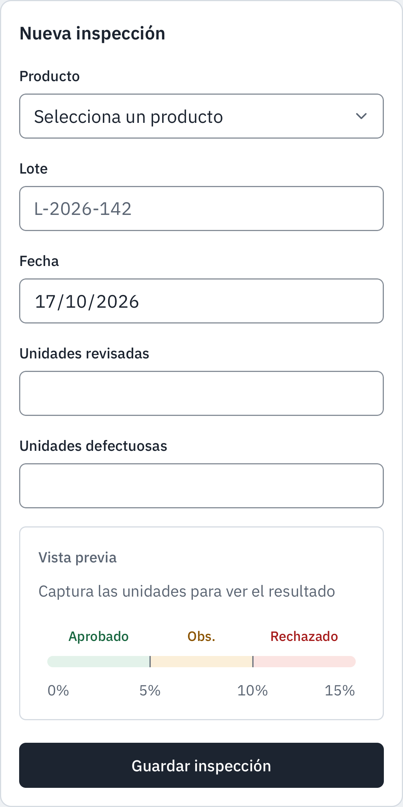

# Manual de usuario

Guía de uso de la pantalla de inspecciones de calidad, para inspectores que registran lotes y supervisores que consultan el historial.

## Contenido

- [Qué es la pantalla](#qué-es-la-pantalla)
- [Registrar una inspección](#registrar-una-inspección)
- [Qué significa cada resultado](#qué-significa-cada-resultado)
- [Filtrar y leer el registro](#filtrar-y-leer-el-registro)
- [Tarjetas de resumen](#tarjetas-de-resumen)
- [Mensajes de error y qué hacer](#mensajes-de-error-y-qué-hacer)
- [Uso en celular](#uso-en-celular)

## Qué es la pantalla

La pantalla registra cada inspección por muestreo de un lote y calcula su resultado automáticamente. Se abre en [inspecciones-calidad.vercel.app](https://inspecciones-calidad.vercel.app) y no requiere iniciar sesión.

Tiene tres zonas:

| Zona                         | Para qué sirve                                                         |
| ---------------------------- | ---------------------------------------------------------------------- |
| **Nueva inspección**         | Formulario para capturar una inspección.                               |
| **Tarjetas de resumen**      | Totales de lo que se está viendo en el registro.                       |
| **Registro de inspecciones** | Historial con filtros, de la inspección más reciente a la más antigua. |

## Registrar una inspección

1. En **Producto**, elige el producto del catálogo (por ejemplo, "P003 Desarmador").
2. En **Lote**, escribe el identificador del lote, de hasta 50 caracteres (por ejemplo, "L-2026-142").
3. En **Fecha**, deja la de hoy o elige el día en que se hizo la inspección. No se aceptan fechas futuras.
4. En **Unidades revisadas**, escribe cuántas piezas se revisaron (entero mayor que cero).
5. En **Unidades defectuosas**, escribe cuántas salieron con defecto (entero, de cero hasta el número de revisadas).
6. Revisa la **Vista previa** y pulsa **Guardar inspección**.

### Vista previa y medidor

En cuanto las dos cantidades son válidas, la vista previa muestra el porcentaje de defectos y el resultado que tendrá la inspección, antes de guardarla.

El **medidor de tolerancia** ubica ese porcentaje en una barra con tres zonas: Aprobado (0 a 5%), Con observaciones (5 a 10%) y Rechazado (más de 10%). Si el porcentaje pasa de 15%, la aguja se queda al final y la escala marca "15%+".

### Al guardar

- Aparece el aviso **"Inspección guardada"** y la nueva fila se resalta un momento en el registro.
- El formulario conserva el producto y la fecha, y limpia lote y cantidades para capturar el siguiente lote.
- Si hay filtros activos y la inspección no coincide con ellos, el aviso agrega: "No aparece en la lista por los filtros activos."

## Qué significa cada resultado

El resultado se calcula con el porcentaje de unidades defectuosas sobre las revisadas. En pantalla, cada resultado lleva siempre icono y texto, no solo color.

| Resultado         | Porcentaje de defectos | Ejemplo                           |
| ----------------- | ---------------------- | --------------------------------- |
| Aprobado          | Hasta 5% (inclusive)   | 1 de 20 = 5.00%                   |
| Con observaciones | Más de 5% y hasta 10%  | 1 de 19 = 5.26%; 1 de 10 = 10.00% |
| Rechazado         | Más de 10%             | 1 de 9 = 11.11%                   |

Los límites son inclusivos: exactamente 5% es Aprobado y exactamente 10% es Con observaciones.

## Filtrar y leer el registro

**Filtrar por producto** muestra solo las inspecciones de un producto. **Filtrar por resultado** muestra solo Aprobado, Con observaciones o Rechazado; "Todos" quita ese filtro.

Los dos filtros se combinan. **Limpiar filtros** aparece cuando hay alguno activo y los quita todos. Los filtros quedan en la dirección de la página, así que al recargar o compartir el enlace se conservan.

Cada fila muestra:

| Columna     | Contenido                                |
| ----------- | ---------------------------------------- |
| Fecha       | Día de la inspección                     |
| Producto    | Nombre y código                          |
| Lote        | Identificador capturado                  |
| Revisadas   | Unidades revisadas                       |
| Defectuosas | Unidades con defecto                     |
| % defectos  | Defectuosas ÷ revisadas, con 2 decimales |
| Resultado   | Aprobado, Con observaciones o Rechazado  |

El orden es por fecha de inspección, de la más reciente a la más antigua; si dos inspecciones tienen la misma fecha, primero va la última capturada.

En pantallas medianas la tabla se compacta (el código va bajo el nombre y el lote bajo la fecha) y en pantallas angostas cada inspección se muestra como tarjeta.

## Tarjetas de resumen

Las tarjetas resumen exactamente lo que muestra el registro. Si hay filtros, arriba aparece "Mostrando:" con los filtros activos y los totales son solo de esas inspecciones.

| Tarjeta                | Qué dice                                                  |
| ---------------------- | --------------------------------------------------------- |
| **Inspecciones**       | Cuántas hay y cuántas de cada resultado.                  |
| **Unidades revisadas** | Total de piezas revisadas y cuántas salieron defectuosas. |
| **Defectos globales**  | Total de defectuosas ÷ total de revisadas.                |

**Defectos globales no es un promedio de porcentajes.** Cada pieza cuenta igual: una inspección de 100 piezas pesa más que una de 10. Con 100 revisadas sin defectos y 10 revisadas con 2 defectos, el global es 2 ÷ 110 = 1.82%, no 10%.

**"Sin datos"** aparece cuando no hay ninguna inspección en lo que se está viendo: sin piezas revisadas no hay porcentaje que calcular.

## Mensajes de error y qué hacer

### En el formulario

Los errores aparecen debajo de cada campo al salir de él o al pulsar Guardar; el cursor va al primer campo con error. Nada se guarda mientras haya errores.

| Mensaje                                                          | Qué hacer                                          |
| ---------------------------------------------------------------- | -------------------------------------------------- |
| Selecciona un producto.                                          | Elige un producto de la lista.                     |
| El producto seleccionado no existe.                              | Recarga la página y elige un producto de la lista. |
| El lote es obligatorio.                                          | Escribe el identificador del lote.                 |
| El lote no puede tener más de 50 caracteres.                     | Acorta el identificador.                           |
| La fecha es obligatoria.                                         | Elige una fecha.                                   |
| La fecha no puede ser futura.                                    | Usa la fecha de hoy o una anterior.                |
| La fecha no existe en el calendario.                             | Corrige el día o el mes.                           |
| Las unidades revisadas son obligatorias y deben ser un número.   | Escribe un número.                                 |
| Las unidades revisadas deben ser un número entero.               | Quita los decimales.                               |
| Las unidades revisadas deben ser mayores que cero.               | Escribe al menos 1.                                |
| Las unidades defectuosas son obligatorias y deben ser un número. | Escribe un número; si no hubo defectos, escribe 0. |
| Las unidades defectuosas deben ser un número entero.             | Quita los decimales.                               |
| Las unidades defectuosas no pueden ser negativas.                | Escribe 0 o más.                                   |
| Las unidades defectuosas no pueden ser más que las revisadas.    | Revisa ambas cantidades.                           |
| La cantidad es demasiado grande.                                 | Revisa que no sobren dígitos.                      |

### Al guardar o cargar

| Mensaje                                                                    | Qué pasa                                           | Qué hacer                                    |
| -------------------------------------------------------------------------- | -------------------------------------------------- | -------------------------------------------- |
| No se pudo guardar la inspección. Revisa tu conexión e inténtalo de nuevo. | No se guardó; lo capturado sigue en el formulario. | Revisa la conexión y pulsa Guardar otra vez. |
| No se pudieron cargar las inspecciones.                                    | El registro no llegó.                              | Pulsa **Reintentar**.                        |
| No se pudieron cargar los productos.                                       | La lista de productos no llegó.                    | Pulsa **Reintentar** junto al mensaje.       |

Si el problema continúa, avisa al equipo técnico con la hora aproximada del error.

## Uso en celular

La pantalla funciona en cualquier celular con navegador, sin instalar nada. Todo se acomoda en una columna: formulario, tarjetas de resumen y registro.

- Las cantidades abren el teclado numérico.
- El registro se muestra como tarjetas, una por inspección, con fecha, resultado, producto, lote y cifras.
- El filtro por resultado se muestra en dos renglones para que cada opción sea fácil de tocar.
- No hay desplazamiento horizontal: todo cabe a lo ancho de la pantalla.

| Pantalla de 390 px                                | iPhone (Safari)                                      |
| ------------------------------------------------- | ---------------------------------------------------- |
|  |  |
